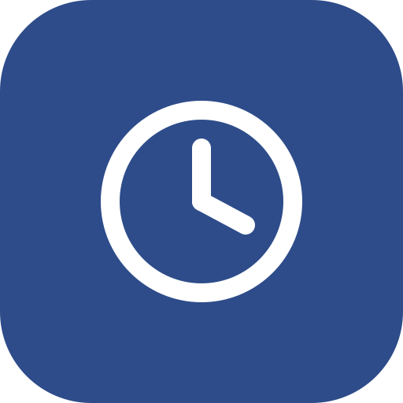
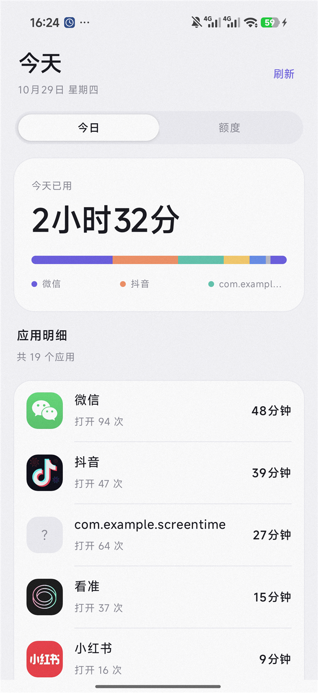
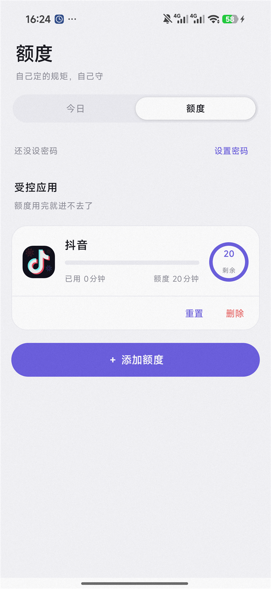
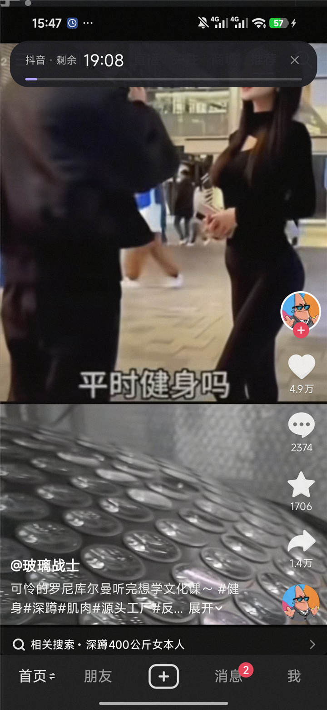
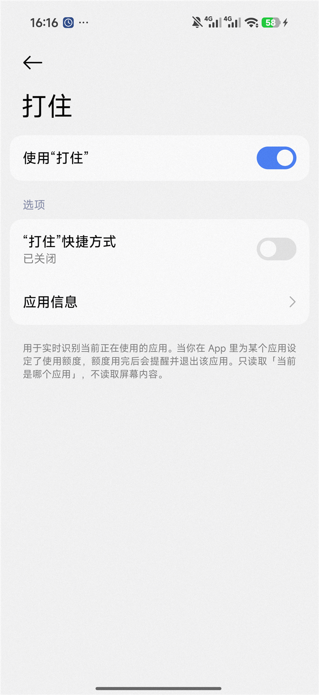

<div align="center">



# Halt · 打住

**给某个 App 定一个额度，用完就真的进不去了。**

一个用无障碍服务做实时拦截的 Android 自律工具 —— 不是提醒你，是把你踢出去。

[](#-只支持-android)
[](#)
[](#)
[](#)
[](LICENSE)

<a href="../../releases/latest"></a>

<sub>6.6 MB · Android 8.0+ · 无需 Google 服务</sub>

</div>

---

## ⚠️ 只支持 Android

这一点必须先说清楚，因为它决定了这个项目能不能解决你的问题：

| | iOS | Android |
|---|---|---|
| 读取其他 App 的使用时长 | ❌ 做不到 | ✅ `UsageStatsManager` |
| 知道"现在前台是哪个 App" | ❌ 做不到 | ✅ 无障碍服务 |
| 到点把 App 拦下来 | ⚠️ 只能靠系统自己的「屏幕使用时间」限额 | ✅ 可以 |
| 自定义额度 / 重置密码 / 倒计时横幅 | ❌ | ✅ |

**iPhone 上做不了。** iOS 的 Screen Time 框架（`FamilyControls` / `DeviceActivity`）只允许系统自己渲染报告，第三方 App 既读不到明细，也没法主动拦别的 App。越狱插件除外。

所以 Halt 是 Android 专属的。

---

## 这是什么

刷抖音之前先问自己一句「今天还有多少额度」——然后照做。Halt 把这句话变成了强制执行的规则：

- 你给某个 App **填一个时长**（比如抖音 20 分钟）
- 用它的时候，屏幕顶部挂着一条**倒计时胶囊**，每时每刻都在走
- 剩余 5 分钟提醒，到点再给 5 分钟宽限
- 宽限也用完，**直接把你踢回桌面**，再点进来还是踢
- 想看更多时间？可以，但得输 **PIN** 把额度重置

关键点：它不靠「提醒」，靠**执行**。

<table>
<tr>
<td align="center"><br><sub>今天用了多久</sub></td>
<td align="center"><br><sub>额度自己填</sub></td>
<td align="center"><br><sub>倒计时胶囊，盖在任何 App 上</sub></td>
</tr>
</table>

---

## 为什么做这个

市面上的专注类 App 大多在做三件事：番茄钟、白名单、数据统计。但它们有同一个问题 —— **只能提醒你，拦不住你**。

而 Android 上唯一能做到「到点真的动不了」的东西是无障碍服务。Halt 就是把这条路子走完整：权限怎么开、状态怎么判断、服务被杀怎么自恢复、改系统时间怎么防。它不像一个计时器，更像一把锁。

---

## 功能

| | |
|---|---|
| 🎯 **额度自己填** | 选一个 App，填分钟数。没有模板，你说多少就是多少 |
| ⏱ **实时倒计时** | 顶部悬浮胶囊，每秒走一格。可以划走，划走这次不再打扰 |
| 🔔 **三段式提醒** | 剩 5 分钟通知 → 到点通知 → 5 分钟宽限后强退 |
| 🚪 **真的进不去** | 额度用完后，每次打开都被遮罩盖住并踢回桌面 |
| 🔒 **PIN 保护** | 重置/删除额度要密码 —— 不然三秒就能破解自己 |
| 📊 **今日统计** | 每个 App 用了多久、打开几次，彩色分布条一眼看清 |
| 🛡 **自恢复** | 会话时间落盘，进程被杀后补记；服务被关会主动通知你 |
| 🌙 **深色模式** | 跟着系统走 |

---

## 下载安装

**不想编译？直接下 APK：**

[**⬇ Halt-v0.1.0.apk**](https://github.com/KlayPeter/Halt/releases/download/v0.1.0/Halt-v0.1.0.apk) · 6.6 MB · 已签名

1. 手机上下载这个 APK，允许「安装未知来源应用」
2. 打开 Halt → 「额度」页 → 按提示开三个权限（见下一节）
3. 设置 4 位密码 → 点「＋ 添加额度」→ 选 App、填分钟数

<details>
<summary>校验签名（可选）</summary>

```
SHA-256: 98739ababb4d7313d3f6097ec19c83b709aad91d7cf357a8b0fdc08b8bab53f3
```

</details>

---

## 开启权限（最关键的一步）

打开 Halt → 「额度」页 → 顶部会提示还差什么。

**① 无障碍服务**

```
设置 → 无障碍 → 已下载的应用 → Halt → 打开
```

系统会弹「开启服务将会：查看和控制屏幕…」，**必须点「允许」**，不点等于没开。

<div align="center"><br><sub>找「Halt」，下面那行小字是「实时识别当前应用，兑现使用额度」</sub></div>

**② 显示在其他应用上层**：设置 → 应用 → Halt → 特殊权限 → 悬浮窗

**③ 通知**：系统弹窗点允许即可

三个都开了，额度页的红色提示卡才会消失。

> **为什么非要无障碍？** 因为普通应用拿不到「现在前台是哪个 App」，`UsageStatsManager` 只能给事后统计，做不到当场拦下来。PIN、看数据、设额度都不需要它 —— 不开的话，Halt 只是一个统计工具。

---

## 怎么工作的

### 状态机

额度判断被抽成一个**纯函数**（[`Enforcer.kt`](app/src/main/java/com/klaypeter/halt/enforcement/Enforcer.kt)），不碰任何 Android 对象，所以能单元测试：

```kotlin
fun decide(input: GuardInput): Decision   // Allow / Block(reason, usedMs, budgetMs)
```

| 状态 | 条件 | 动作 |
|---|---|---|
| 正常 | 已用 < 额度 | 计时 + 常驻进度通知 |
| 预警 | 剩余 ≤ 5 分钟 | 通知 |
| 到点 | 已用 ≥ 额度（正在玩） | 通知，进入宽限 |
| 宽限 | 到点后 5 分钟内 | 每秒检查 |
| 封锁 | 宽限也过完 | 遮罩 + 踢回桌面 + 尽力回收后台 |
| 再进入 | 封锁后再打开 | 直接遮罩 + 踢 |

```bash
./gradlew :app:testDebugUnitTest
```

```
✓ 没设额度的应用放行        ✓ 已经用完再点进来直接拦
✓ 额度没用完放行            ✓ 到点后在宽限期内不拦
✓ 宽限也用完就拦            ✓ 忽略的包名放行
✓ 拨号永不拦截              ✓ 已用 = 库里累计 + 本次会话
```

### 架构

```
enforcement/          纯逻辑 + 保活，可测试
  Enforcer.kt           该不该拦（纯函数）
  GuardianService.kt    前台服务，抬高进程优先级
  GuardNotifications.kt 通知渠道 / ID

guard/                Android 相关，只负责执行
  GuardService.kt       无障碍事件 → 计时 → 决策 → 执行
  OverlayController.kt  全屏遮罩
  BannerOverlay.kt      顶部倒计时胶囊（可划走）
  Notifier.kt           通知
  GuardHealthWorker.kt  15 分钟自检服务是否还活着
  BootReceiver.kt       开机拉起守护

data/                  Room：额度、使用时长
security/              PIN：PBKDF2 + 随机盐
ui/                    Compose：今日 / 额度 / 密码盘
```

### 四个权限各管一件事

| 权限 | 只负责 |
|---|---|
| 无障碍服务 | 知道前台是谁 + 调 `performGlobalAction(HOME)` 把你踢出去 |
| 使用情况访问 | 「今日」页的统计 |
| 悬浮窗 | 遮罩和倒计时胶囊 |
| 通知 | 预警和常驻状态 |

---

## 从源码构建

- JDK 17+
- Android SDK（Platform 34 + Build-Tools 34）
- 手机 Android 8.0+

```bash
git clone https://github.com/KlayPeter/Halt.git
cd Halt

# 告诉 Gradle SDK 在哪
echo "sdk.dir=/path/to/Android/Sdk" > local.properties

./gradlew :app:assembleDebug
# 产物：app/build/outputs/apk/debug/app-debug.apk
```

Windows 上可以直接用仓库里的脚本（会自动从 `ANDROID_HOME` 或 `local.properties` 找 SDK）：

```bat
build.bat      :: 只编译
install.bat    :: 编译 + 装到手机 + 重绑无障碍
```

> 小米/红米报 `INSTALL_FAILED_USER_RESTRICTED`，是开发者选项里的「USB 安装」没开；另外 **adb 安装时手机必须亮屏解锁**。

---

## 已知限制

诚实地说清楚边界：

- **强退不是真的杀进程**。普通应用没有 `force-stop` 别人的权限，`killBackgroundProcesses` 在 Android 14+ 上大概率被系统忽略。Halt 用的是 `HOME + 遮罩`，体验等价，但不是把进程干掉
- **拦截有 200–500ms 延迟**。无障碍事件到达后才动作，所以点开那一瞬间可能闪一下内容（现在改成先盖遮罩、再踢，看到的是遮罩）
- **国产 ROM 会杀后台**。必须把 Halt 的省电策略设成「无限制」+ 允许自启动，否则守护会悄悄失效。Halt 有个 15 分钟一次的自检，掉了会发通知
- **上架 Google Play 会被拒**。无障碍 API 只允许用于辅助残障用户，这个用途不符合政策。自用或上国内商店没问题
- **改系统时间绕不过去**（这是好事）：计时用的是单调时钟 `elapsedRealtime`

## Roadmap

- [x] 额度 + 实时拦截 + 倒计时胶囊
- [x] PIN 保护重置
- [x] 进程被杀后的时长补记
- [x] 服务自检 + 开机自启
- [x] 签名 APK / Release
- [ ] 额度按天自动重置
- [ ] 指纹解锁（BiometricPrompt）
- [ ] 完成任务 → 回来兑换额度（`grantedMinutes`）
- [ ] 周报 / 趋势图
- [ ] 应用白名单：给「必须能用」的 App 开豁免

## 技术栈

Kotlin · Jetpack Compose (Material 3) · Room · WorkManager · Coroutines
无障碍服务 / WindowManager 悬浮窗 / NotificationCompat / PBKDF2

## License

[MIT](LICENSE) © 2026 KlayPeter

---

<div align="center">
<sub>如果你也一直被「再看五分钟」骗，这个项目就是为你写的。</sub>
</div>
